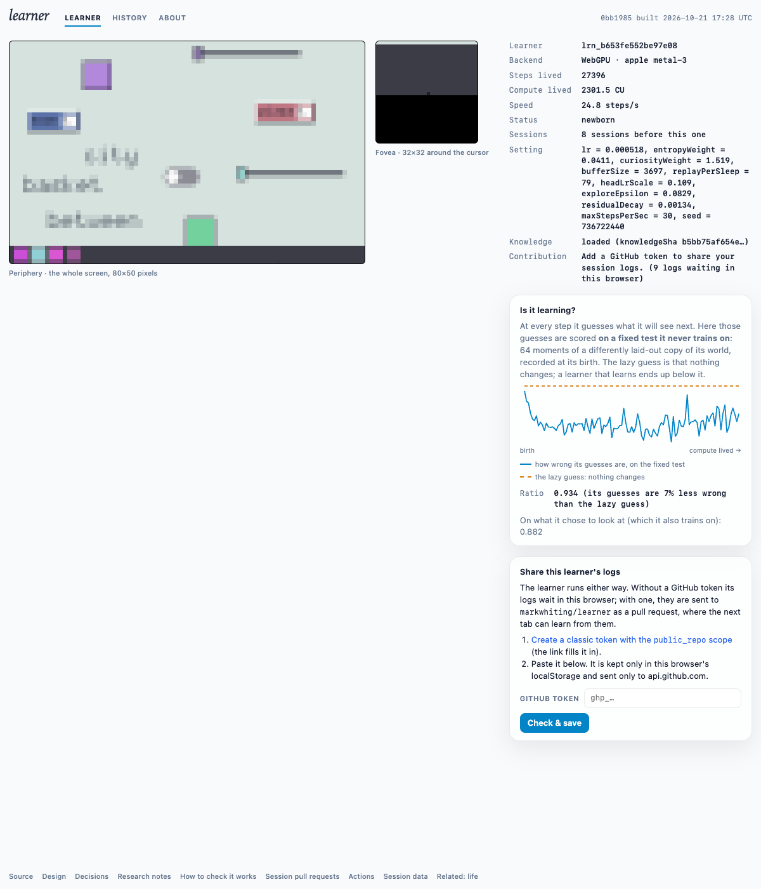

# Does it learn? Live run 2 (fovea-shift prior, held-out check)

**Date:** 2026-10-21. **Build:** 0bb1985 (Plan 04a.2, merged as 4332893). **Where:** https://markwhiting.github.io/learner/, headless Chromium on an Apple M4 (WebGPU, metal-3), no token, 20 minutes, `caffeinate` on, load average about 4. (A first attempt was lost when the machine restarted; this is the rerun.)

## Summary
**Yes, a little, and it then stops improving.** On the fixed held-out set (64 moments from a differently laid-out world, never trained on), the learner's prediction error stayed below the "nothing changes" guess at every sample: ratio **0.88–0.95** over 27,394 steps (2,301 CU). Run 1 sat at 1.00 throughout.

**It did not reach the 0.8 bar.** The best reading came early (0.884 at 4 minutes). The ratio then drifted up to 0.93–0.95 by the end, as in the offline probe. The own-stream ratio (0.87–0.96) now roughly tracks the held-out one, so it is no longer misleading in the way decision 0015 found.

**The platform held up.** Speed was 25–28 steps/s, with one dip to 14.7 at 12 minutes. No device loss. No network hosts other than the page's own.

## Samples
| min | steps | CU | steps/s | held-out ratio | own-stream ratio |
|---|---|---|---|---|---|
| 2 | 2,817 | 236 | 27.4 | 0.894 | 0.898 |
| 4 | 5,395 | 451 | 25.2 | 0.884 | 0.950 |
| 6 | 8,119 | 681 | 26.3 | 0.924 | 0.957 |
| 8 | 10,937 | 917 | 26.7 | 0.912 | 0.922 |
| 10 | 13,750 | 1,152 | 26.7 | 0.890 | 0.914 |
| 12 | 16,504 | 1,388 | 14.7 | 0.898 | 0.870 |
| 14 | 19,226 | 1,613 | 25.1 | 0.928 | 0.927 |
| 16 | 21,954 | 1,843 | 27.8 | 0.920 | 0.926 |
| 18 | 24,669 | 2,072 | 25.7 | 0.953 | 0.947 |
| 20 | 27,394 | 2,301 | 24.7 | 0.934 | 0.882 |

**Settings drawn for this learner:**
- lr 5.18e-4, headLrScale 0.109, exploreEpsilon 0.0829, residualDecay 1.34e-3
- entropyWeight 0.0411, curiosityWeight 1.519, bufferSize 3697, replayPerSleep 79

## Caveats
- **One run, one machine, one draw of settings.** The ratio is shown to 3 significant digits.
- **This is prediction only.** A lower ratio says the learner models its world a bit better. It says nothing about whether it can *do* anything; milestones and checkups (Plan 04b) measure that (AGENTS.md invariant 8).
- **Drift after the early best** matches the offline probe. It is the target of consolidation, conditions B and C, in Plan 05. It is not tuned here.
- **At the end, the cursor sat on the taskbar in the places room.** The fovea showed mostly the dark bar.

## Next
Plan 04b, Growing up: the caregiver, milestones M1–M6, and checkups on fresh variants.
