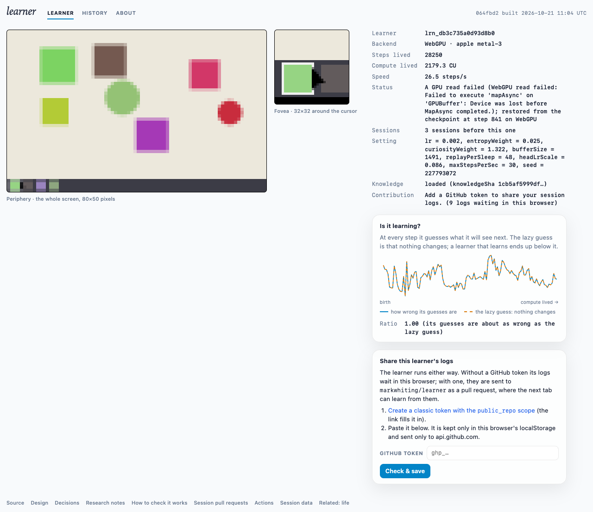

# Does it learn? First live run of the real learner

**Date:** 2026-10-21. **Build:** 064fbd2 (Plan 04a.1). **Where:** https://markwhiting.github.io/learner/, headless Chromium on an Apple M4 (WebGPU, metal-3), no token, 20 minutes, `caffeinate` on, load average about 7.

## Summary
**No. Not yet, in the real world.** Over 28,250 steps (2,179 CU), the learner's prediction error stayed level with the "nothing changes" guess: ratio 1.00 throughout, and the two curves lie on top of each other. On the synthetic training streams it does beat that guess (0.79–0.88 after 3,000 steps, Plan 04a), so the gap is specific to the real four-room world.

**The platform held up.**
- **Speed:** a steady 25–26 steps/s, against a cap of 30.
- **Device loss recovered:** the GPU device was lost once early on. The tab restored from its checkpoint (step 841) and carried on, on WebGPU.
- **Network:** no requests to any host other than the page's own.
- **Forever lives:** working as designed. "Compute lived" has no limit.

## Samples
| min | steps | CU | steps/s | ratio |
|---|---|---|---|---|
| 2 | 2,503 | 193 | 17.5 | 1.00 |
| 4 | 5,241 | 402 | 24.9 | 1.00 |
| 6 | 8,115 | 626 | 25.7 | 1.00 |
| 8 | 11,000 | 847 | 25.2 | 1.00 |
| 10 | 13,750 | 1,060 | 26.2 | 1.00 |
| 12 | 16,626 | 1,283 | 25.4 | 1.00 |
| 14 | 19,500 | 1,504 | 26.0 | 1.00 |
| 16 | 22,399 | 1,728 | 25.8 | 1.00 |
| 18 | 25,333 | 1,956 | 26.1 | 1.00 |
| 20 | 28,250 | 2,179 | 26.5 | 1.00 |

**Settings drawn for this learner:** lr 0.002, headLrScale 0.086 (residual output layers at about 1.7e-4), entropyWeight 0.025, curiosityWeight 1.32, bufferSize 1491, replayPerSleep 48.

## Caveats and next step
- One run, one machine, one set of settings. The ratio is shown to 3 significant digits, so a gain under 0.5% would not show.
- The learner stays mostly in the crib, where frames are nearly static apart from the cursor. The fovea, though, moves with the cursor, so its content shifts whenever the cursor moves.
- **Next:** a diagnostic investigation, reproducing offline in the real world with full-precision losses split into periphery and fovea. It will check that the residual output layers actually move, then test candidate fixes before Plan 04b.
