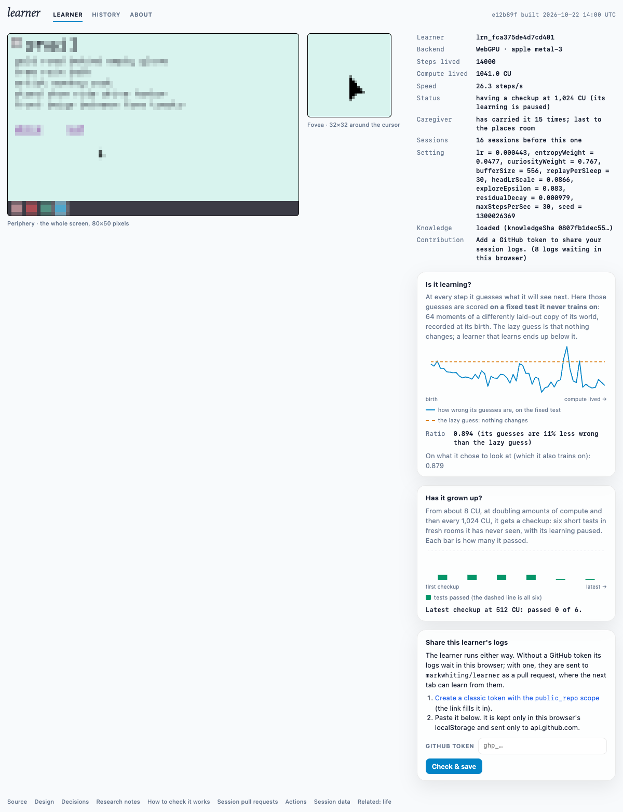

# Growing up, live: first checkups and caregiver (live run 3)

**Date:** 2026-10-22. **Build:** e12b89f (Plan 04b, merged as 0a90532). **Where:** https://markwhiting.github.io/learner/, headless Chromium on an Apple M4 (WebGPU, metal-3), no token, 20 minutes, `caffeinate` on, load average about 2. CI and deploy were green.

## Summary
- **Checkups ran and were honest, but the curve is flat at chance.** Six checkups finished: 16, 32, 64, 128, 256 and 512 CU. The 8 CU level was merged into 16, as designed. The scores were 1, 1, 1, 1, 0 and 0 of 6.
  - The early passes were M4 (three times) and M3 (once). Newborns pass those by luck about 18% and 13% of the time (decision 0016, "Newborn base rate").
  - The later checkups passed nothing. **There is no evidence yet that it can *do* anything** (spec §2 allows this first result).
- **Prediction improved, and M1 is moving toward its bar.**
  - M1's measure (prediction loss ÷ copy-last, on a fresh crib/toys room) went from 0.987 to 0.957, 0.907, 0.931 and then **0.865**. The pass bar is < 0.8.
  - The held-out ratio ended at **0.894**, with a best reading of 0.864 at 16 minutes. It also had one excursion above 1.0 mid-run, visible in the screenshot.
- **The caregiver worked.** It carried the learner 15 times: places 6, hide-and-seek 5, toys 3, crib 1 (log files 0–7). Safety-net mode was never reached, since M6 was never passed.
- **The logs are sound.**
  - All 8 queued files pass `parseLogFile`, and the whole set passes the gate's `validateSessionPr` (`ok: true`).
  - `cu` excludes checkups. Each checkup cost 21.9 evalCU at GPU widths.
- **The cost is real.** The learner reached 1,041 CU in 20 minutes, against 2,301 in run 2. An estimated ~55% of wall time went to checkups and held-out scoring. This is an estimate: 14,000 learning steps at ~25.5 steps/s is ~550 s of the 1,200 s. That share is dense early by design and thins out once checkups come only every 1,024 CU.

## Samples
| min | steps | CU | steps/s | held-out ratio | own-stream ratio | latest checkup | caregiver carries |
|---|---|---|---|---|---|---|---|
| 2 | 500 | 36 | 22.9 | 0.981 | 0.979 | 16 CU: 1 of 6 (M4) | 0 |
| 4 | 1,000 | 73 | 25.1 | 0.971 | 0.948 | 32 CU: 1 of 6 (M3) | 1 |
| 6 | 1,750 | 129 | 24.8 | 0.954 | 0.921 | 64 CU: 1 of 6 (M4) | 3 |
| 8 | 2,381 | 177 | 22.3 | 0.952 | 0.915 | 128 CU: 1 of 6 (M4) | 3 |
| 10 | 3,500 | 259 | 25.2 | 0.923 | 0.912 | 128 CU | 5 |
| 12 | 5,577 | 415 | 24.4 | 0.926 | 0.956 | 256 CU: 0 of 6 | 8 |
| 14 | 7,000 | 520 | 25.7 | 0.914 | 0.871 | 256 CU | 8 |
| 16 | 9,039 | 673 | 20.4 | 0.864 | 0.866 | 512 CU: 0 of 6 | 9 |
| 18 | 12,000 | 892 | 25.7 | 0.908 | 0.860 | 512 CU | 12 |
| 20 | 14,000 | 1,041 | 26.3 | 0.894 | 0.879 | (1,024 CU running) | 15 |

## What each checkup measured
Pass bars, from decision 0016:

| Milestone | What is measured | Pass bar |
|---|---|---|
| M1 | prediction loss ÷ copy-last | < 0.8 |
| M2 | interactive-hover ratio | ≥ 2 |
| M3 | responsive-click ratio | ≥ 2, with at least 3 clicks |
| M4 | fraction of hidden content revealed | ≥ 0.6 |
| M5 | pages visited ÷ the random clickers' mean | ≥ 1.5, with at least 4 pages |
| M6 | taskbar switches it made itself | ≥ 3 |

The measures at each level:

| level | M1 | M2 | M3 | M4 | M5 | M6 | passed |
|---|---|---|---|---|---|---|---|
| 16 | 0.987 | 0.481 | 0.428 | 0.667 | 2.087 | 0 | M4 |
| 32 | 0.987 | 0.905 | 2.009 | 0.583 | 1.455 | 0 | M3 |
| 64 | 0.957 | 0.541 | 1.817 | 0.727 | 0.400 | 2 | M4 |
| 128 | 0.907 | 0.256 | 0 | 0.944 | 0.381 | 0 | M4 |
| 256 | 0.931 | 1.014 | 0 | 0.265 | 1.231 | 0 | — |
| 512 | 0.865 | 0.665 | 0.278 | 0.316 | 0.400 | 0 | — |

M5 at 16 CU scored 2.087, but it failed the 4-page floor, the agent's tightening in 0016.

**Settings drawn for this learner:**
- lr 4.43e-4, headLrScale 0.0866, exploreEpsilon 0.083, residualDecay 9.79e-4
- entropyWeight 0.0477, curiosityWeight 0.767, bufferSize 556, replayPerSleep 30
- caregiver prior: period 500, τ 0.05, ε 0.1

## Caveats
- **One run, one machine, one draw of settings.** No checkup score here is above the newborn base rate, so none of them is evidence of development (invariant 8).
- **Checkup wall time was not timed directly.** It is inferred from steps lived.
- **The M2/M5 tightenings and the newborn base rates are agent calls, not yet confirmed by the user** (0016).
- **What to watch next:**
  - Whether M1 crosses 0.8 in longer lives; it is the closest milestone.
  - Whether the held-out excursions (drift) shrink once consolidation lands in Plan 05.
