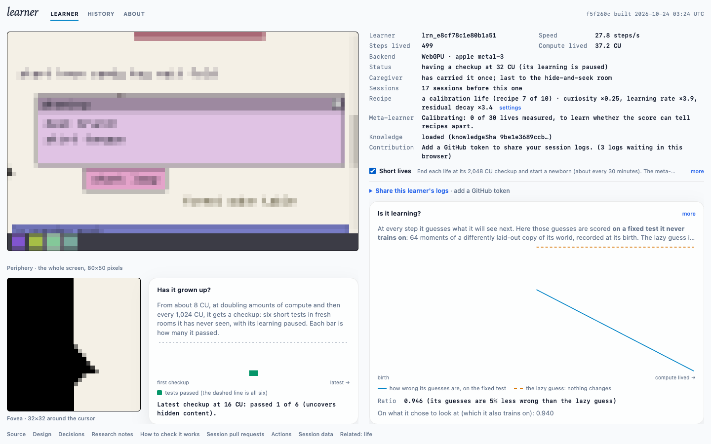

# Meta-learner foundations, live (Plan 05a)

**Date:** 2026-10-24.
**Build:** f5f260c, which is Plan 05a (merged as fa510df) plus the Linux layout fix. CI and deploy were green.
**Where:** https://markwhiting.github.io/learner/, in headless Chromium on an Apple M4 (WebGPU, metal-3), with no token and `caffeinate` on.

## Summary
- **The gate's first meta commit worked.** A manual `gate` run computed `data/meta` and committed it straight to `main` as `github-actions[bot]`.
  - The commit was `9eb880a`, "meta: calibrate, 0 eligible lives, posterior a55026dc". It changed only `data/meta/**` (4 files), pushed on the first try, and triggered a deploy.
  - So the Actions token can push to `main`, which decision 0019 relies on.
  - The site then served `knowledge/posterior.json` in mode `calibrate`, with 10 calibration genomes and schema 1.
- **Births are seeded and recomputable.** Each tab drew a calibration recipe from the served posterior (sha `a55026dc`). For both lives, `birthDraw` recomputed in Node from the learnerId and the served posterior bytes gave the same method, `drawSeed` and genome.
- **Short lives work.** With the switch on, the first life (`lrn_e8cf78c1e80b1a51`, recipe 7 of 10) ran its checkups at 16, 32, 64, 128, 256, 512, 1,024 and 2,048 CU. It then ended, with a final file marked `meta.end: "budget"` at 2,059 CU, after about 29 minutes.
  - A newborn (`lrn_6a078485e073e1cc`) started at once in the same tab. It had a different `drawSeed` (3773830574 vs 1466227185) and a different genome.
- **Logs are valid.** All 13 queued files parse, and both lives pass the gate's `validateSessionPr` with `knowledge/genome-space.json` (`ok: true`). The page logged no errors.
- **The finished life scores eligible.** Scoring the finished life with `search-composite@1` behaves as follows:
  - With no newborn reference, it is ineligible, reason "no newborn reference". That is the state today.
  - With a placeholder reference, it is eligible and uses its 512, 1,024 and 2,048 checkups. That confirms the final-review fix: before it, the 2,048 checkup sat in a later file and no real life could ever be scored.
- **Speed:** 26–29 steps/s, with brief dips to 15–17. This is in line with Plan 04c.

## Not done yet
- **The gate folding a life in (plan Task 13 Step 5).** This needs a token in the tab, so the life's PR and the next posterior's `diagnostics.perGenome` are still to come.
- **A pre-05a forever life resuming as `legacy` (Step 3): since verified live.** The user's tab reloaded onto the new code and resumed `lrn_a4c5ddf56297aa1e`, born 2026-10-22, as a legacy life. Files 3–6 carry `meta.role "legacy"`, and the gate merged them through the new git-based reader in PR #27, using 1 gh call for the PR and 4 for the whole run. Legacy lives are never scored.
- **The newborn reference.** It is not pinned, so no search life is eligible yet. Next:
  1. Run `?newborns=0-63`, about 4.3 h on one machine.
  2. Collect the files with `tools/eval/collect-newborns` into `data/newborns/`.
  3. Build the reference with `tools/eval/newborn-reference.ts`, and commit it with a recorded decision.
- **The calibration signal check.** It needs 30 eligible short lives, about 15 hours of tabs with the switch on. Phase 05a counts as done only once the signal check has answered (spec §10).

## Caveats
- **One machine and one browser.** A tab's draw and the gate's recompute agreed exactly here. That has not been tried on other browsers, though the page-side detmath golden test covers Chromium.
